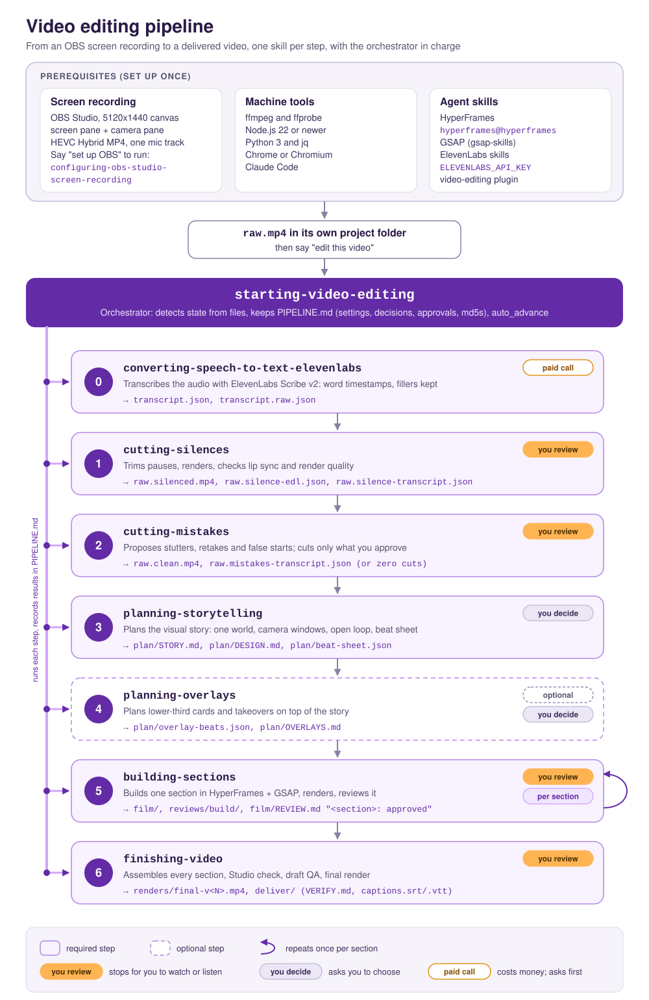

# video-editing

Edit a talking-head or screen recording from raw footage to a delivered video: transcribe it, cut silences and spoken mistakes, plan the visual story and overlays, build it section by section in HyperFrames, then assemble, check and render the final.

Every step is a tested prompt kept word for word in its skill. Each step plans first, and the orchestrator (`starting-video-editing`) runs them in order.

## Prerequisites

Set these up once per machine.

### 1. Screen recording with OBS Studio

The pipeline expects recordings made to one spec: a 5120x1440 canvas with a 2560x1440 screen pane and a 2560x1440 camera pane, HEVC in Hybrid MP4, one mic track, and global start, stop and pause hotkeys.

Say **"set up OBS"** to run the `configuring-obs-studio-screen-recording` skill. It:
1. checks the tools on your Mac and gives install commands for anything missing (it installs nothing without your approval);
2. walks you through OBS panel by panel, then reads OBS's saved settings to confirm every value (it never edits OBS's files);
3. checks a 30 second test recording: streams, keyframes, panes, camera rate, audio, and a clap test for lip sync.

### 2. Machine tools

| Tool | Install |
|------|---------|
| ffmpeg and ffprobe | `brew install ffmpeg` (the skills call `/opt/homebrew/bin/ffprobe`, so they assume Homebrew on macOS) |
| Node.js 22 or newer | `brew install node` (for `npx hyperframes`) |
| Python 3 | comes with the Xcode Command Line Tools (`xcode-select --install`), or `brew install python`. The helper scripts use only the standard library. |
| jq | `brew install jq` |
| Chrome or Chromium | [google.com/chrome](https://www.google.com/chrome/) or `brew install --cask chromium` |
| Claude Code | `brew install --cask claude-code`, or [claude.com/claude-code](https://claude.com/claude-code) |

### 3. Agent skills

| Skill set | Used by | Install |
|-----------|---------|---------|
| HyperFrames (HeyGen) | building-sections, finishing-video | the `hyperframes@hyperframes` plugin, or `npx skills add heygen-com/hyperframes`. If you also have the older copy from the official marketplace (0.8.61), remove it: it doesn't know the `history` command these skills use. |
| GSAP (GreenSock) | building-sections, finishing-video | `/plugin marketplace add greensock/gsap-skills`, then install from it |
| ElevenLabs | converting-speech-to-text-elevenlabs | `npx skills add elevenlabs/skills` |
| video-editing | everything | `/plugin marketplace add jek-bao-choo/productivity-plugins`, then `/plugin install video-editing@productivity-plugins` |

Run `/reload-plugins` after installing.

### 4. ElevenLabs API key

Set `ELEVENLABS_API_KEY` in your environment or in a `.env` file in the project folder. Only transcription uses it, plus one optional fresh transcription in finishing-video. Both are paid calls; they upload audio only, never the video, and tell you the file size and cost before sending.

## How to run

1. Copy the recording into its own folder as `raw.mp4`.
2. Open Claude Code in that folder and say **"edit this video"**.
3. On the first run, answer the settings it asks for, all at once: the folder to reuse helper scripts from, whether to plan overlays, fresh transcription at the end, final render quality, privacy and a pinned HyperFrames CLI.

With `auto_advance` on (the default), the run keeps going and stops only for:
- a video or audio clip you need to review (files go to `reviews/<step>/`, with a Review block giving the path, sound on or off, and timecodes);
- a HyperFrames Studio review;
- a decision only you can make (asked with a recommended option first; replying "approve" takes the recommendations);
- a paid call you haven't approved yet.

Every other stop is approved automatically and logged in `PIPELINE.md`.

Other things to say:
- "where am I": show the steps, the sections and what's next.
- "continue" or "next": run the next step.
- "just cut the silences" or "only plan overlays": run one step, if its inputs are ready.
- "redo the silence cut" or "re-plan the story": archive that step's outputs and run it again, after showing what becomes stale.

You can also run any skill on its own by naming it, for example "run cutting-mistakes".

## Skills

| # | Skill | What it does | Main outputs | Stops for you |
|---|-------|--------------|--------------|---------------|
| | `configuring-obs-studio-screen-recording` | One-time setup: checks the Mac's tools, walks you through OBS, verifies a 30s test recording | a verified OBS profile, `/tmp/obs-setup/` reports | each phase |
| | `starting-video-editing` | Orchestrator: detects state, runs the next skill, keeps the ledger | `PIPELINE.md` | settings, once |
| 0 | `converting-speech-to-text-elevenlabs` | Transcribes the audio with ElevenLabs Scribe v2, keeping fillers and word timestamps | `transcript.json`, `transcript.raw.json` | paid call |
| 1 | `cutting-silences` | Trims pauses, renders, checks lip sync and render quality | `raw.silenced.mp4`, `raw.silence-*` | review |
| 2 | `cutting-mistakes` | Proposes stutters, retakes and false starts; cuts only what you approve (zero cuts is fine) | `raw.clean.mp4`, `raw.mistakes-*` | review |
| 3 | `planning-storytelling` | Plans the visual story: one world, camera windows, an open loop, the beat sheet | `plan/STORY.md`, `plan/DESIGN.md`, `plan/beat-sheet.json` | concept, canvas and colours |
| 4 | `planning-overlays` (optional) | Plans lower-third cards and takeovers on top of the story | `plan/overlay-beats.json`, `plan/OVERLAYS.md` | thresholds and which cards to keep |
| 5 | `building-sections` (once per section) | Builds one section in HyperFrames with GSAP, renders it, checks sync, reviews it | `film/`, `reviews/build/`, the `<section>: approved` line in `film/REVIEW.md` | review of each section |
| 6 | `finishing-video` | Assembles every section, Studio check, draft QA, final render, SRT and VTT captions | `renders/final-v<N>.mp4`, `deliver/` with `VERIFY.md` and `captions.srt` / `.vtt` | Studio, draft and final review |

## What PIPELINE.md records

- **Project:** the source path, the `raw.mp4` md5 and the date.
- **Settings:** asked once, passed to every skill.
- **Steps table:** each step's status (todo, in progress, awaiting approval, done, skipped or stale), its key outputs and their md5s at approval.
- **Sections table:** each section's times, build order and approval.
- **Decisions:** everything you chose that a later step needs, so you're never asked twice.
- **Approvals log:** every approval, including those auto_advance gave, with dates.

If an upstream file changes after approval, every later step is marked stale and nothing runs on top of it until you decide.

## Things to know

- **Reused scripts.** Several skills reuse helper scripts (`cut_silences.py`, `cut_mistakes.py`, `story_tools.py`, `beats_tools.py`, `finish_tools.py`) from a previous video's folder. The orchestrator asks once for that folder (`tools_from`) and fills in each skill's `<PATH TO PREVIOUS FOLDER>`. If a script is missing, the skill writes it from the spec in its prompt and runs its self-test first.
- **Nothing is overwritten.** Outputs open with mode `"x"`, renders get new version numbers, and inputs are checked by md5 at the end of each step.
- **Privacy.** Frames, renders and transcripts stay on your machine. The only outside calls are the ElevenLabs transcriptions, and they send audio only. HyperFrames AI describe, upload and share options stay off, and the skills don't pass `--skill`, which tags renders in HyperFrames' anonymous usage telemetry. The CLI may still send its own anonymous telemetry; run `npx hyperframes telemetry` to see or turn it off.
- **No logos or brand marks.** The design system follows Datadog colours by default, but these are personal learning videos, not official content.

**Example prompts:**
- "Set up OBS"
- "Edit this video"
- "Where am I?"
- "Transcribe raw.mp4"
- "Cut the silences"
- "Build section s2"
- "Finish the video"
